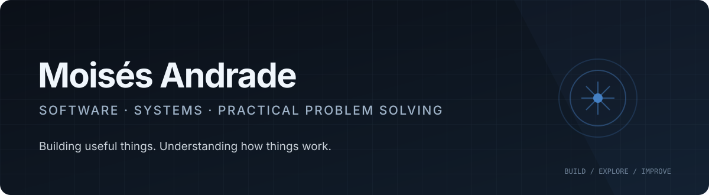

  

   

  
  
  

    

  **I build software, explore technology, and turn practical problems into useful solutions.**

---

## `01` — Profile

I'm a multidisciplinary professional working across **software development, construction operations, team coordination, and quality assurance**.

My experience in construction has given me a practical understanding of how projects operate on the ground: coordinating people and resources, solving site issues, maintaining quality and safety standards, and improving everyday processes.

Alongside that experience, I've spent years developing software and building digital tools. I enjoy working across the stack, from backend logic and APIs to frontend interfaces, databases, and deployment environments.

I'm also curious about the technology we use every day. I enjoy **hacking things around me**: taking devices apart, figuring out how they work, repurposing hardware, experimenting with electronics, and automating repetitive tasks. Sometimes the best project starts with a simple question: *"Could this work differently?"*

My interests sit at the intersection of **software, systems, hands-on experimentation, and real-world problem solving**.

## `02` — Technologies

### Languages & Frameworks

### Data, Infrastructure & Tools

| Area | Tools & experience |
|---|---|
| **Languages** | Python, JavaScript, SQL |
| **Frontend** | Vue.js, HTML5, CSS3, Bootstrap |
| **Backend** | Django, Flask, Node.js, NestJS, Express |
| **APIs** | REST, GraphQL |
| **Databases** | PostgreSQL, MySQL, MongoDB |
| **Infrastructure** | Docker, Kubernetes, Linux |
| **Workflow** | Git, debugging, code reviews, issue tracking |

## `03` — What I Do

- **Application development** — building and maintaining full-stack applications.
- **Backend & APIs** — developing, integrating, and troubleshooting REST and GraphQL services.
- **Problem solving** — investigating bugs, tracing issues, and improving existing systems.
- **Automation** — reducing repetitive work through scripts, integrations, and practical tooling.
- **Technical experimentation** — exploring devices, hardware, home technology, and unconventional uses for everyday tools.
- **Construction operations** — site coordination, team leadership, quality assurance, inspections, reporting, and workflow improvement.

## `04` — Selected Project

### SiteForce / GRID

CONSTRUCTION TECHNOLOGY · PERSONAL DEVELOPMENT CONCEPT

A construction-focused software concept exploring connected site workflows and drawing-based measurement.

The goal is to make site information easier to capture, understand, and act on, while bringing practical tools closer to the people doing the work.

**Areas of exploration**

- Site reports, observations, and photo documentation.
- Task and project information.
- 2D drawing measurement and calibration.
- Digital workflows shaped by real construction-site needs.

## `05` — GitHub Overview

  

    

  

---

**Curious by nature. Practical by experience. Always building.**

Thanks for visiting my profile.

